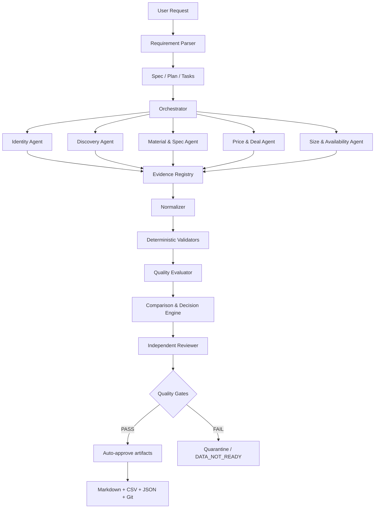

# Shopping Intelligence Architecture
Version: 1.0.0
Operating model: Hybrid multi-agent
Approval: Automatic for quality-gated repository artifacts
Persistence: Git + CSV/JSON

## Architecture

## Hybrid responsibility model
- Orchestrator: decomposes work, assigns agents, tracks dependencies, merges evidence; cannot alter user hard constraints.
- Specialist agents: research bounded domains and return structured claims plus evidence; cannot issue final BUY.
- Deterministic services: schema validation, identity rules, freshness, hard-constraint gates, scoring arithmetic.
- Independent reviewer: reviews from source records and requirements, not merely the primary agent's summary.
- Release controller: auto-approves only repository artifacts passing all gates.

## Storage contract
Git is the source of truth for versioned specs, prompts, schemas, tests, curated snapshots, reports, and changelog.
CSV stores flat appendable registries and exports. JSON stores structured requests, products, evidence, offers, observations, decisions, and run manifests.
Raw page bodies or copyrighted material are not mirrored by default. Store permitted excerpts/locators, hashes, URLs, and retrieval metadata.

## Directory contract
- spec-kit/: constitution, feature specs, plans, tasks, architecture
- prompts/: orchestrator and specialist prompts
- schemas/: JSON Schema contracts
- data/requests/: immutable request snapshots
- data/catalog/: curated products and variants
- data/evidence/: source/evidence registry
- data/offers/: time-stamped offer and availability observations
- data/decisions/: immutable decision snapshots
- reports/: generated Markdown/CSV outputs
- tests/: schema, rule, regression, and adversarial tests
- CHANGELOG.md: meaningful system changes

## Agent output contract
Every agent returns: task_id, agent_id, run_id, status, claims[], evidence_refs[], conflicts[], unknowns[], recommendations[], limitations[], generated_at.
Claims must be atomic and field-scoped. No evidence reference means no verified claim.

## Decision separation
Hard constraints are evaluated first. A weighted preference score can rank only candidates that pass hard constraints. Missing critical evidence produces DATA_NOT_READY. BUY is a recommendation state only; transaction execution remains outside this system.
